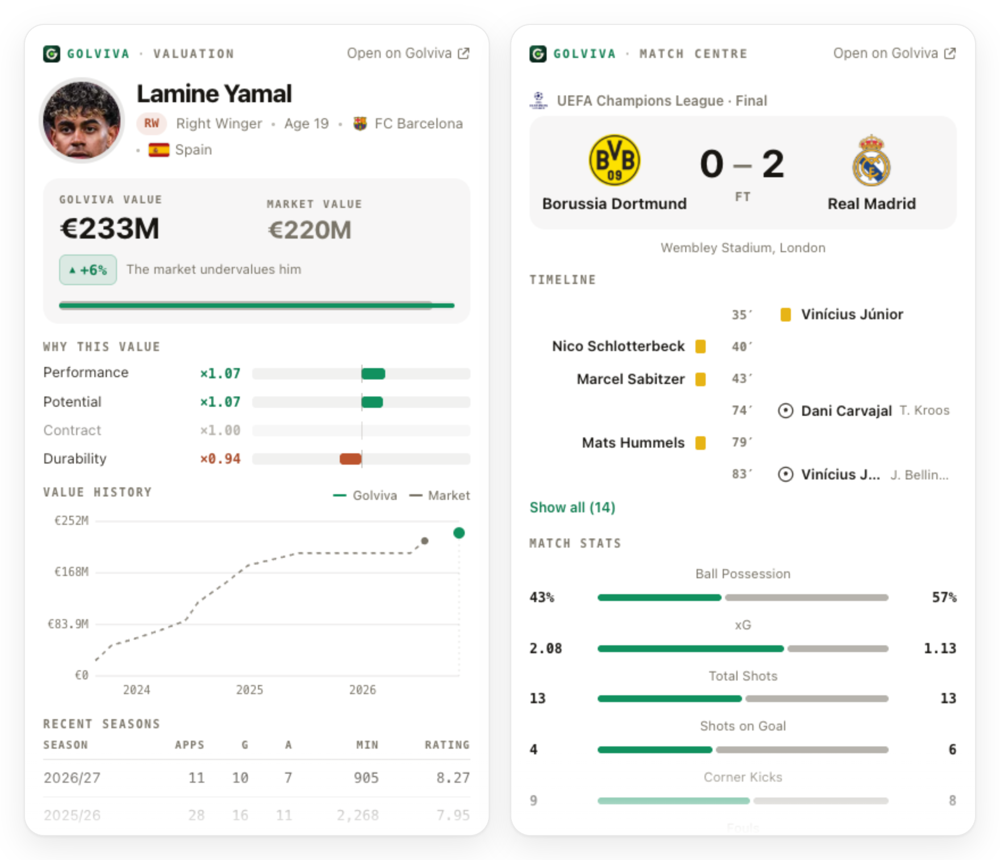
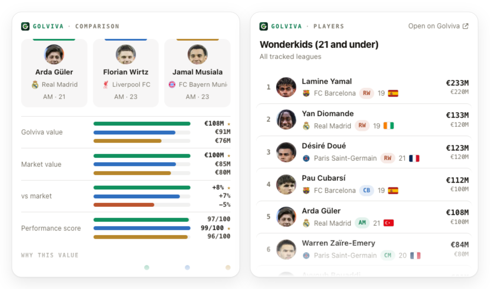
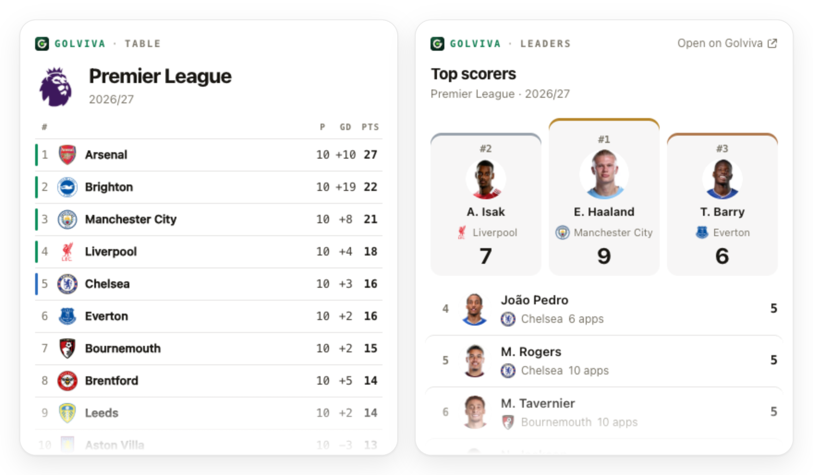

<div align="center">


# Golviva MCP server

**Who wins the match? What is every footballer really worth? Ask your assistant.**

Match predictions for every game of Europe's top leagues, season projections, independent player
valuations with the reasons behind them, plus live scores, match centres, league tables, stat
leaders and transfer news — in Claude, ChatGPT, Cursor, VS Code and any other MCP client.

[](https://golviva.com/en/mcp)
[](https://modelcontextprotocol.io)
[](#tools)
[](LICENSE)

[](https://cursor.com/install-mcp?name=golviva&config=eyJ1cmwiOiJodHRwczovL2FwaS5nb2x2aXZhLmNvbS9tY3AifQ%3D%3D)
[](https://insiders.vscode.dev/redirect/mcp/install?name=golviva&config=%7B%22type%22%3A%22http%22%2C%22url%22%3A%22https%3A%2F%2Fapi.golviva.com%2Fmcp%22%7D)

<picture>
  <source media="(prefers-color-scheme: dark)" srcset="https://raw.githubusercontent.com/target1m/golviva-mcp/master/assets/hero-dark.png">
  
</picture>

</div>

[Golviva](https://golviva.com/) is built around the goal: live scores and match pages first, and
behind them a match model and its own estimated transfer value for every player in Europe's top
divisions, MLS and the Saudi Pro League — shown next to the market value, with the gap explained
factor by factor. This repository documents Golviva's **hosted MCP server**, which puts the
predictions, the valuations and the live game straight into your assistant. Answers render as
**interactive cards** in clients that support MCP Apps (Claude, ChatGPT), and as clean structured
data everywhere else.

## Connect in a minute

Nothing to install, nothing to run — Golviva is a remote server:

```
https://api.golviva.com/mcp
```

Sign in with Apple or Google when your client asks. Every account includes a **free daily allowance** of
tool calls; a typical question uses one to three.

**Claude** (web, desktop, mobile) — Settings → Connectors → **Add custom connector** → name it
*Golviva*, paste the URL → **Connect** → sign in.

**ChatGPT** — open [Plugins](https://chatgpt.com/plugins) → **+** → **Add custom MCP server** →
name *Golviva*, paste the URL, authentication **OAuth** → confirm and **Create as a plugin** → sign
in, then type **@Golviva** in a chat (or pick it from the **+** menu). Custom MCP servers depend on
your ChatGPT plan and workspace settings.

**Claude Code**

```bash
claude mcp add --transport http golviva https://api.golviva.com/mcp
```

Then run `/mcp`, choose *golviva* → **Authenticate**. To get the four [skills](#skills-plugin)
with it, install this repository as a plugin instead:

```
/plugin marketplace add target1m/golviva-mcp
/plugin install golviva@golviva-mcp
```

**Gemini CLI** — the extension adds the server and the four [skills](#skills-plugin):

```bash
gemini extensions install https://github.com/target1m/golviva-mcp
```

Then run `/mcp auth golviva` once inside Gemini CLI to sign in.

**Cursor** — use the **Add to Cursor** button above, or add it to `~/.cursor/mcp.json` and click
*Needs login*:

```json
{ "mcpServers": { "golviva": { "url": "https://api.golviva.com/mcp" } } }
```

**VS Code** — use the **Install in VS Code** button above, or:

```bash
code --add-mcp '{"name":"golviva","type":"http","url":"https://api.golviva.com/mcp"}'
```

**Any other client** — add a remote (Streamable HTTP) server with the URL. The server is a
standard OAuth 2.1 resource server with its own authorization server (dynamic client registration,
client ID metadata documents, PKCE and OpenID Connect), so clients that speak MCP authorization run
the sign-in by themselves. **No browser sign-in?** Create a personal API key at
[golviva.com/en/mcp](https://golviva.com/en/mcp#account) (shown once, revocable any time) and send
it as a Bearer token:

```bash
claude mcp add --transport http golviva https://api.golviva.com/mcp --header "Authorization: Bearer fvk_your_key"
```

## Try asking

| Ask | Golviva answers with |
|---|---|
| *"Predict Real Madrid's next match: chances, likely scorers and line-ups."* | `get_match_prediction` — win/draw/loss chances, likeliest scores, goals, likeliest scorers, predicted line-ups |
| *"Who will win the Premier League, and who will go down?"* | `get_season_projection` — every club's title, top-four, Europe and relegation chances |
| *"What are Golviva's match predictions for today?"* | `get_predictions` — the model's 10 most confident calls of the day, graded after the final whistle |
| *"What is Lamine Yamal really worth — and why?"* | `get_player` — value vs market, the verdict, the factors behind it, value history |
| *"Compare Arda Güler, Florian Wirtz and Jamal Musiala."* | `compare_players` — one card, every factor side by side |
| *"Left-footed centre-backs under 23 in Serie A worth less than €30M."* | `find_players` — a scouting shortlist |
| *"Who are the most undervalued players in the Premier League?"* | `get_rankings` — where Golviva sees more than the market |
| *"What are today's scores?"* | `get_matches` — live, finished and upcoming, by competition |
| *"Show me the match centre of the last Champions League final."* | `get_match` — events, team stats, line-ups with ratings |
| *"Show me the Süper Lig table."* | `get_standings` — points, form, qualification and relegation zones |
| *"Who are the Champions League top scorers?"* | `get_stat_leaders` — season leaderboards across competitions |
| *"Any Galatasaray transfer news?"* | `get_transfer_news` — confirmed deals and rumours with their reliability |

## What it looks like

Every answer is a card you can explore — click a player, club or match inside it and the next
card opens in place.

<picture>
  <source media="(prefers-color-scheme: dark)" srcset="https://raw.githubusercontent.com/target1m/golviva-mcp/master/assets/valuations-dark.png">
  
</picture>

<picture>
  <source media="(prefers-color-scheme: dark)" srcset="https://raw.githubusercontent.com/target1m/golviva-mcp/master/assets/football-dark.png">
  
</picture>

<sub>Cards follow the host's language (8 languages, Arabic right to left) and its light or dark
theme. Screenshots show live data from November 2026 — values and tables move as Golviva updates
them.</sub>

## How Golviva values a player

Golviva starts from the market value and expresses **where it disagrees**. Each factor
multiplies the value, every factor is bounded, and thin data keeps the estimate close to the
market rather than inventing a story.

| Factor | What it measures |
|---|---|
| **Performance** | Output against what the player's price predicts inside his position and league-strength cohort — performing above his price lifts the value |
| **Potential** | Where players of the same age, position and price have historically gone next: young players read above their price (less so the pricier they already are), players past their prime below it |
| **Contract** | Leverage the selling club loses as the contract runs down |
| **Durability** | Injuries over the last two seasons |

Within **±5 %** of the market the verdict is *fair*; above it the market undervalues the player,
below it the market overvalues him. More on the model: [golviva.com/en/about](https://golviva.com/en/about).

## Tools

18 tools, **all read-only** — Golviva never posts, buys or changes anything. Each one declares a
title, all four MCP hints (`readOnlyHint`, `destructiveHint`, `idempotentHint`, `openWorldHint`)
and its OAuth security scheme, so your client can show what a call does before you allow it. Most arguments
take plain names ("Arda Güler", "Süper Lig", "Turkey") as well as ids.

### Predictions

| Tool | What it does |
|---|---|
| `get_match_prediction` | Golviva's prediction for one match — by match id, team (its next match) or league (its upcoming matches): the model's home win, draw and away win chances, the likeliest scores, total goals and both teams to score, the likeliest scorers, the predicted line-ups (the confirmed ones about an hour before kick-off) and, after the final whistle, whether it came in. Every match of the leagues Golviva values and of the Champions League, Europa League and Conference League, from about a day and a half before kick-off. |
| `get_season_projection` | A league's projected final table: the rest of the season played out thousands of times with the match model's ratings — each club's chance of the title, the top four and the Champions League places, Europe and relegation, and its expected points. Refreshed every 6 hours. |
| `get_predictions` | Golviva's daily match predictions: the 10 most confident calls of its statistical model (match result, double chance, total goals or both teams to score), locked in every morning before the first kick-off, each with the model's probability, the likeliest score and scorers, the live or final score and whether it came in, plus the hit rate over the last 7 and 30 days. Model probabilities, not odds or betting advice. |

### Valuations

| Tool | What it does |
|---|---|
| `get_player` | A player's Golviva value next to the market value, the gap and its verdict, the factor breakdown, value history, season stats, transfers, contract and similar players. |
| `compare_players` | 2–4 players side by side: values, age, position, performance percentile, every valuation factor and last-season output. |
| `find_players` | Scout by league, club, nation, position, age, preferred foot and value range; sort by value, market value, undervalued, overvalued, youth, performance or recent rise. |
| `get_rankings` | Most valuable, most undervalued / overvalued (€10M+), biggest risers / fallers, wonderkids (21 and under). |
| `search_football` | Find players, clubs, leagues and national teams by name, accents optional. |

### Leagues, clubs, national teams

| Tool | What it does |
|---|---|
| `list_leagues` | Every league Golviva values, with strength tier, clubs, players and total squad value. |
| `get_league` | A league's clubs ranked by squad value (Golviva vs market) and its most valuable players. |
| `get_club` | A club's squad with every player's Golviva value, market value and the gap, plus totals. |
| `get_national_team` | The strongest 26-player squad for a nation (3 GK / 8 DF / 8 MF / 7 FW by value). |

### Matches

| Tool | What it does |
|---|---|
| `get_matches` | Live scores, results and fixtures — live, today, yesterday, tomorrow or any date — across leagues, European and domestic cups and national-team tournaments. |
| `get_match` | One match in depth: score, event timeline, team statistics and line-ups with ratings. |
| `get_team_fixtures` | A club's or national team's next or most recent matches. |
| `get_standings` | A competition's table with form and qualification / relegation zones. |

### Statistics & transfers

| Tool | What it does |
|---|---|
| `get_stat_leaders` | Season leaderboards — goals, assists, goals + assists, minutes, appearances — per competition, across national-team competitions, or across all competitions combined. |
| `get_transfer_news` | Latest confirmed transfers and rumours with fees, clubs, reliability and dates. |

Every argument, type and default — generated from the server's own registrations:
[`skills/value-and-compare-players/references/tools.md`](skills/value-and-compare-players/references/tools.md).

## Privacy & limits

- **Read-only.** No tool writes, posts, buys or deletes anything.
- **You sign in with Apple or Google.** Golviva sees the tool calls your assistant makes — never your
  conversation. If your assistant asks for it when you connect (ChatGPT does), Golviva shares your
  account's e-mail address and name with it; the sign-in screen says so before you allow it.
- **Free daily allowance** for every account. Usage, connected apps and API keys live at
  [golviva.com/en/mcp](https://golviva.com/en/mcp#account); disconnecting an app ends its access
  immediately.
- Full details: [privacy policy](https://golviva.com/en/privacy) ·
  [terms of service](https://golviva.com/en/terms) · [help & support](https://golviva.com/en/support).

## Skills (plugin)

The tools are the capability; the skills are the judgement about which tool to reach for and how
to read the answer. This repository is also an installable **plugin** with four skills:

| Skill | What it teaches |
|---|---|
| [`follow-matches-and-tables`](skills/follow-matches-and-tables/SKILL.md) | Scores, match centres, fixtures, tables, match predictions and season projections — UTC dates, local kick-off times, never an invented score, probabilities never sold as certainties |
| [`value-and-compare-players`](skills/value-and-compare-players/SKILL.md) | Read a valuation honestly: value vs market, the ±5 % fair band, what each factor means, and when thin data keeps the value close to the market |
| [`scout-and-rank-players`](skills/scout-and-rank-players/SKILL.md) | Turn a scouting brief into filters, pick the right ranking, read squads, leagues and national teams |
| [`stats-and-transfer-news`](skills/stats-and-transfer-news/SKILL.md) | Leaderboards by competition and season; transfer news with its reliability spelled out |

```
plugin.json                       portable manifest (Agent Plugins 1.0.0) + ChatGPT/Codex listing metadata
.claude-plugin/plugin.json        the same, for clients that read this path
.claude-plugin/marketplace.json   makes this repository a Claude Code plugin marketplace
mcp.json                          the hosted server, for Agent Plugins hosts (Codex, ChatGPT)
.mcp.json                         the hosted server, for Claude Code
gemini-extension.json             Gemini CLI extension (server + skills, OAuth sign-in)
server.json                       official MCP Registry manifest (com.golviva/golviva)
glama.json                        Glama maintainers
skills/<name>/SKILL.md            one workflow each
assets/                           logo, plugin icons and README screenshots
```

## Links

- Golviva: <https://golviva.com/>
- MCP setup page with a live demo: <https://golviva.com/en/mcp>
- How the model works: <https://golviva.com/en/about>
- Privacy: <https://golviva.com/en/privacy>
- Terms: <https://golviva.com/en/terms>
- Help & support: <https://golviva.com/en/support> · admin@golviva.com
- Official MCP Registry name: `com.golviva/golviva`
- Security reports: [SECURITY.md](SECURITY.md)

## About this repository

Documentation, manifests and skills for a hosted service; Golviva's own source is not public.
Questions, bugs and ideas about the MCP server are welcome as
[issues](https://github.com/target1m/golviva-mcp/issues).
